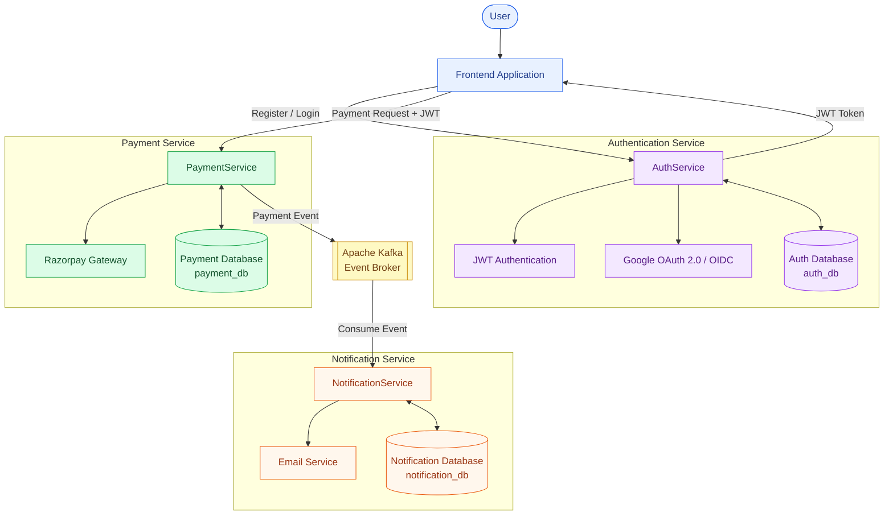

# 🎓 Education Payment System

A microservices-based Education Payment System built using **Java, Spring Boot, Spring Security, Apache Kafka, Docker, MySQL, JWT, OAuth 2.0, and Razorpay**.

This project demonstrates microservices architecture, secure authentication and authorization, event-driven communication, asynchronous messaging, payment gateway integration, and database persistence.

---

## 📌 Project Overview

The system allows students to register, authenticate, purchase courses, and receive payment notifications.

The application consists of three independent microservices:

1. **AuthService** – Handles user registration, login, JWT authentication, and Google OAuth 2.0 login.
2. **PaymentService** – Handles course payment orders and Razorpay integration.
3. **NotificationService** – Consumes Kafka events and sends email notifications.

### Complete Workflow

1. User registers or logs in.
2. AuthService authenticates the user and issues a JWT.
3. User initiates a course payment.
4. PaymentService creates a Razorpay payment order.
5. After successful payment, a Kafka event is published.
6. NotificationService consumes the event.
7. Email notification is sent to the student.
8. Notification logs are stored in MySQL.

---

## 🏗️ System Architecture



---

## 🚀 Features

### 🔐 Authentication & Security (AuthService)

- User registration and login.
- JWT-based authentication.
- JWT token generation and validation.
- Password encryption using BCrypt.
- Stateless authentication using Spring Security.
- Google OAuth 2.0 login integration.
- OpenID Connect (OIDC) authentication.
- Secure authentication endpoints.
- Role-based authorization foundation.

### 💳 Payment Management (PaymentService)

- Razorpay payment order creation.
- Payment processing integration.
- Payment details persistence.
- Kafka event publishing.
- Secure payment configuration.

### 📧 Notification Management (NotificationService)

- Kafka event consumption.
- Asynchronous email notifications.
- Email notification logging.
- Database persistence.

### ⚙️ Infrastructure

- Microservices architecture.
- Apache Kafka producer-consumer communication.
- Dockerized MySQL databases.
- Docker Compose.
- Environment-based configuration.
- PowerShell automation scripts.

---

## 🛠️ Tech Stack

### Backend Development

- Java 21
- Spring Boot
- Spring Security
- Spring Data JPA
- Hibernate
- REST APIs
- Maven

### Authentication & Authorization

- JWT (JSON Web Token)
- OAuth 2.0
- OpenID Connect (OIDC)
- Google OAuth 2.0
- BCrypt Password Encryption

### Messaging

- Apache Kafka
- Event-Driven Architecture
- Asynchronous Communication

### Database

- MySQL 8
- Spring Data JPA

### DevOps & Infrastructure

- Docker
- Docker Compose
- PowerShell Automation

### Payment Gateway

- Razorpay API

### Development Tools

- IntelliJ IDEA
- VS Code
- Postman
- Git
- GitHub

---

## 📦 Microservices

### 1️⃣ AuthService

**Port:** `8081`

**Database:** `auth_db`

**Responsibilities:**

- User registration and login.
- Password encryption using BCrypt.
- JWT access token generation.
- JWT validation using Spring Security.
- Stateless authentication.
- Google OAuth 2.0 login.
- OpenID Connect integration.
- Authentication success handling.

**Authentication Flow:**

```text
         User
          |
          ▼
    AuthService
          |
          ▼
    Spring Security
          |
          ▼
    Authentication
          |
          ▼
      JWT Token
          |
          ▼
    Protected APIs
```

**Google Login Flow:**

```text
User
 |
 ▼
Sign in with Google
 |
 ▼
Google Authorization Server
 |
 ▼
User Authentication
 |
 ▼
Authorization Code
 |
 ▼
AuthService
 |
 ▼
ID Token + Access Token
 |
 ▼
OIDC Validation
 |
 ▼
Application Authentication
```

**Database Configuration:**

```text
Database: auth_db
URL: jdbc:mysql://localhost:3306/auth_db
```

---

### 2️⃣ PaymentService

**Port:** `8080`

**Database:** `payment_db`

**Responsibilities:**

- Create Razorpay payment orders.
- Integrate Razorpay payment gateway.
- Process payment workflows.
- Publish payment events to Kafka.
- Store payment information in MySQL.

---

### 3️⃣ NotificationService

**Port:** `8082`

**Database:** `notification_db`

**Responsibilities:**

- Consume Kafka events.
- Process payment notifications.
- Send email notifications.
- Store notification logs.

---

## 🗄️ Database Configuration

| Database | Container | Port |
|---|---|---|
| auth_db | Local MySQL | 3306 |
| payment_db | cfs-payment-mysql | 3308 |
| notification_db | cfs-notification-mysql | 3309 |

Each microservice maintains its own database to support service independence.

---

## 📨 Kafka Configuration

| Property | Value |
|---|---|
| Broker | localhost:9092 |
| Topic | course-enrollment-notification |
| Producer | PaymentService |
| Consumer | NotificationService |

---

## 🔐 Environment Variables

Create a `.env` file in the project root directory.

Example:

```env
# Database
DB_PASSWORD=root

# Razorpay
RAZORPAY_KEY_ID=your_razorpay_key
RAZORPAY_KEY_SECRET=your_razorpay_secret

# Email Configuration
MAIL_USERNAME=your_email@gmail.com
MAIL_PASSWORD=your_app_password

# Google OAuth2
GOOGLE_CLIENT_ID=your_google_client_id
GOOGLE_CLIENT_SECRET=your_google_client_secret
```

Configure the actual property names in each microservice according to its application configuration.

**Important:**
- Never commit `.env` to GitHub.
- Never expose Google Client Secret in frontend code.
- Never expose Razorpay secret keys.
- Keep production credentials in a secure secret manager.

---

## 📁 Project Structure

```text
Education Payment System/
│
├── AuthService/
│   ├── src/
│   │   └── main/
│   │       ├── java/
│   │       │   └── com/
│   │       │       └── cfs/
│   │       │           └── AuthService/
│   │       │               ├── config/
│   │       │               ├── controller/
│   │       │               ├── service/
│   │       │               ├── repository/
│   │       │               ├── entity/
│   │       │               ├── dto/
│   │       │               ├── security/
│   │       │               └── AuthServiceApplication.java
│   │       └── resources/
│   │           └── application.properties
│   └── pom.xml
│
├── PaymentService/
│   ├── src/
│   └── pom.xml
│
├── NotificationService/
│   ├── src/
│   └── pom.xml
│
├── docker-compose.yml
├── start.ps1
├── stop.ps1
├── .env
├── .gitignore
└── README.md
```

---

## ▶️ Running the Project Locally

### Prerequisites

Install the following:

- Java 21+
- Maven
- Docker Desktop
- MySQL
- Git
- Postman

### Step 1 — Clone Repository

```bash
git clone https://github.com/Shevendra77/education-payment-system.git
```

```bash
cd education-payment-system
```

### Step 2 — Configure Environment Variables

Create a `.env` file in the project root and configure the required database, Razorpay, email, and Google OAuth credentials.

### Step 3 — Start Infrastructure

Start the existing Docker containers:

```powershell
docker start cfs-payment-mysql
docker start cfs-notification-mysql
docker start kafka
```

Ensure MySQL for AuthService is running on port `3306` and the `auth_db` database exists.

### Step 4 — Start AuthService

```powershell
cd AuthService
mvn spring-boot:run
```

Service URL:

```text
http://localhost:8081
```

### Step 5 — Start PaymentService

Open another terminal:

```powershell
cd PaymentService
mvn spring-boot:run
```

Service URL:

```text
http://localhost:8080
```

### Step 6 — Start NotificationService

Open another terminal:

```powershell
cd NotificationService
mvn spring-boot:run
```

Service URL:

```text
http://localhost:8082
```

You can also use the existing project startup scripts where configured.

---

## 🌐 Service URLs

| Service | URL | Port |
|---|---|---|
| AuthService | http://localhost:8081 | 8081 |
| PaymentService | http://localhost:8080 | 8080 |
| NotificationService | http://localhost:8082 | 8082 |

---

## 🔄 Authentication & Authorization Flow

### JWT Authentication

```text
User Registration
       |
       ▼
Password Hashing (BCrypt)
       |
       ▼
User Stored in MySQL
       |
       ▼
User Login
       |
       ▼
Credential Validation
       |
       ▼
JWT Generation
       |
       ▼
Client Receives JWT
       |
       ▼
Authorization: Bearer <token>
       |
       ▼
JWT Filter Validation
       |
       ▼
Spring Security
       |
       ▼
Protected API Access
```

### Google OAuth 2.0 + OIDC

```text
User
 |
 ▼
Google Login
 |
 ▼
Authorization Request
 |
 ▼
User Authentication & Consent
 |
 ▼
Authorization Code
 |
 ▼
Token Exchange
 |
 ▼
ID Token + Access Token
 |
 ▼
Token Validation
 |
 ▼
Authenticated User
```

---

## 🔄 Payment Event Flow

```text
1. Student initiates course payment
             |
             ▼
2. PaymentService creates Razorpay order
             |
             ▼
3. Payment is completed successfully
             |
             ▼
4. PaymentService publishes Kafka event
             |
             ▼
5. NotificationService consumes event
             |
             ▼
6. Email notification is sent
             |
             ▼
7. Notification log is saved in MySQL
```

---

## 🧪 Database Verification

### Auth Database

```powershell
mysql -uroot -p
```

```sql
CREATE DATABASE IF NOT EXISTS auth_db;
USE auth_db;
SHOW TABLES;
```

### Payment Database

```powershell
docker exec -it cfs-payment-mysql mysql -uroot -proot
```

```sql
USE payment_db;
SHOW TABLES;
SELECT * FROM payment_orders;
```

### Notification Database

```powershell
docker exec -it cfs-notification-mysql mysql -uroot -proot
```

```sql
USE notification_db;
SHOW TABLES;
SELECT * FROM notification_logs;
```

---

## 🔒 Security Implementation

- JWT-based authentication.
- Password hashing using BCrypt.
- Spring Security integration.
- OAuth 2.0 authorization flow.
- OpenID Connect authentication.
- Stateless JWT security.
- Environment-based secret management.
- Protected API endpoints.
- Secure credential handling.

---

## 📚 Key Learning Outcomes

This project demonstrates practical knowledge of:

- Microservices Architecture.
- REST API Development.
- Authentication and Authorization.
- JWT Authentication.
- OAuth 2.0 and OpenID Connect.
- Spring Security.
- Event-Driven Architecture.
- Apache Kafka Producer and Consumer.
- Asynchronous Communication.
- Docker Containerization.
- MySQL Database Integration.
- Razorpay Payment Gateway.
- Git and GitHub Collaboration.

---

## 🚧 Future Enhancements

- API Gateway.
- Load Balancer.
- Service Discovery.
- Kubernetes Deployment.
- CI/CD Pipeline.
- Swagger/OpenAPI Documentation.
- Redis Caching.
- Centralized Logging.
- Monitoring and Observability.
- Kafka Retry Mechanism.
- Dead Letter Queue (DLQ).
- Distributed Tracing.

---

## 👨‍💻 Author

### Shevendra Chandel

**GitHub:**  
https://github.com/Shevendra77

**Project Repository:**  
https://github.com/Shevendra77/education-payment-system

---

## ⭐ Support

If you find this project useful, consider giving the repository a star on GitHub!
